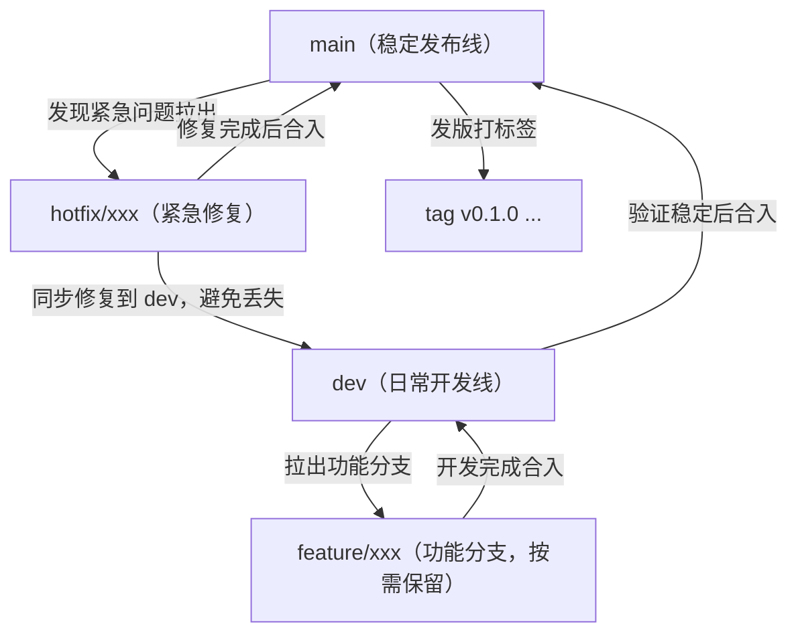

# 06 - Git Rules

## 新项目

Suiji 按全新项目建立。

Git Repository、remote 和 Git 历史均按新项目重新建立。

不要假设存在需要继承的旧 Git 历史或旧 remote。

---

## 分支总览



---

## 仓库关系

Monekin：

```text
学习参考项目（独立参考目录 D:\lx\Desktop\suijiProject\monekin-ref，不是 Git 远程）
```

Suiji：

```text
自己的独立 Git 仓库
origin: https://github.com/xu260120/SuiJi.git（已推送分支：main、dev）
```

Suiji 的代码长期在自己的仓库中维护。

Suiji 仓库没有 Monekin upstream 远程。

---

## 当前主分支

最终发布主分支：

```text
main
```

日常开发主分支：

```text
dev
```

除非用户明确要求，不得擅自改变分支策略。

---

## 分支模型

### 常驻分支（长期存在）

- `main`：稳定发布线，始终保持可运行。只接受 dev 的合并结果与 hotfix 修复，禁止直接在此分支上开发功能。
- `dev`：日常开发集成分支。功能分支完成后合并到此，是日常工作的默认分支。

### 功能分支（按需保留）

- `feature/<功能名>`：从 `dev` 拉出，用于开发单个功能。命名用短横线小写，如 `feature/data-layer`、`feature/asset-page`。
- `hotfix/<问题名>`：从 `main` 拉出，用于修复 main 上需要立即处理的紧急问题。

### 分支保留策略（不强制删除）

- 分支合入 dev 后是否删除不强制。只要该功能后续可能继续迭代，即可保留，避免频繁重建。
- 合入后继续在保留分支上开发新迭代时，先同步 dev 的最新代码（merge dev 进该分支），防止分叉过大。
- 分支列表过长影响使用时，可集中清理一批确定不再维护的分支（如超过 30 天无提交且无计划）。

### 发版（不使用 release 分支，改用 tag）

- 在 `main` 上按语义化版本打标签：`v0.1.0`、`v0.2.0`。

### 合并流程（单向流转）

- `feature/*` → 合入 `dev` 并推送。是否删除分支由实际迭代需求决定。
- 一批功能在 dev 上验证稳定后 → `dev` 合入 `main` → 打 tag。
- `hotfix/*` → 同时合入 `main` 与 `dev`，防止修复在 dev 上丢失。

### 约束

- main 分支策略（作为最终发布主线）未经用户确认不得改变。
- 任何进入 main 的内容必须先在 dev 或功能分支上经过验证。

---

## 操作前检查

进行可能影响代码历史或工作区的 Git 操作前，应检查：

```bash
git status
git diff
git log
```

根据需要检查：

```bash
git remote -v
git branch
```

---

## 保护未提交修改

如果存在：

```text
modified
untracked
staged
```

等用户工作：

不得擅自覆盖。

尤其不能为了“让仓库干净”而删除用户修改。

---

## 高风险操作

以下操作未经用户明确确认不得执行：

```bash
git push --force
git push -f
git reset --hard
```

以及：

- 删除 main
- 删除 Git 历史
- 删除 `.git`
- 更换远程仓库
- 批量覆盖代码
- 强制回退提交
- 清理用户未提交文件

---

## Commit

Commit message 使用中文撰写。

AI 可以根据用户要求帮助：

- 创建 commit
- 整理 commit
- 编写 commit message

但 commit 内容必须与实际修改一致。

不能通过虚假的 commit message 隐藏实际修改。

---

## Commit 逐文件变更说明

每个 commit 的 message 必须按文件逐一说明该文件做了什么修改。

不允许只写一句笼统的概述。

格式：

```text
<type>(<scope>): <一句话总体说明>

- <文件路径>: 该文件具体做了什么修改
- <文件路径>: 该文件具体做了什么修改
```

要求：

- 每个被新增、修改、删除、重命名的文件都必须单独列出一行。
- 每行必须说明「这个文件改了什么」，而不是「这个文件是干什么的」。
- 说明要具体到行为：新增了什么类 / 方法 / 组件、修改了什么逻辑、修复了什么问题。
- 禁止空话：如「修改了一些代码」「优化」「调整」「更新文件」。
- 文件路径使用仓库内相对路径（如 `lib/app.dart`）。
- 没有实际改动的文件不得出现在列表里。
- 文件列表必须与 `git diff --name-status` 的结果一致。

示例：

```text
feat(nav): 完成底部导航栏

- lib/app.dart: 新增 App 根组件，配置 MaterialApp 与主题
- lib/main.dart: 入口改为 runApp(const App())，移除计数器示例
- lib/shell/main_shell.dart: 新增主壳组件，管理当前标签索引与页面切换
- lib/widgets/app_bottom_navigation_bar.dart: 新增底部导航栏，含账本 / 资产 / 统计三个标签与全局「记一笔」按钮
- test/widget_test.dart: 重写测试，改为校验底部导航栏渲染与标签切换
```

---

## Push

任何 push 前，AI 必须先把以下内容完整展示给用户：

- 当前分支与目标 remote
- 将推送的 commit 列表与 message
- commit 涉及的文件
- 本地与 origin 的差异（ahead / behind），是否会覆盖远程内容

展示完整信息后，等待用户明确同意，再执行 push。

未经用户明确同意，不得执行 push。

高风险 push 必须先说明。

---

## Monekin 参考目录

Monekin 参考代码位于 Suiji 仓库之外的 `D:\lx\Desktop\suijiProject\monekin-ref`。

该目录不参与 Suiji 的 Git 历史，不属于 Suiji 仓库。

不得将 Monekin 参考代码克隆、复制或合并进 Suiji 仓库。

---

## Git 历史

Git 历史是项目长期维护的重要资料。

除非用户明确要求：

不得：

- 删除历史
- 重写历史
- 强制推送覆盖远程历史
- 擅自 squash 大量已有提交
